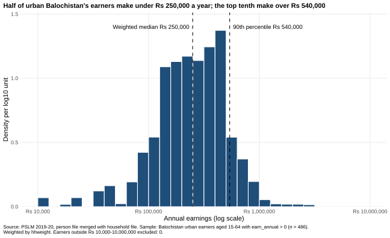
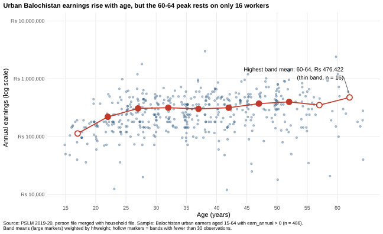

# ECO346 Assignment 1: earnings of urban Balochistan

**Registration no.:** FA24-BEDS-015 (CHECK before submitting)  **Section:** A
**Variant:** 15 = 1 x 8 + 7, so variant 7: **Balochistan, urban** (`prov_code == 4`, `urban_rural == 2`).
Sample: persons aged 15-64 with `earn_annual > 0` (486 earners). All statistics weighted by `hhweight`.

## How to reproduce
From the repository root, with R (packages `ggplot2`, `svglite`) and Python (`pandas`, `numpy`, `matplotlib`):

```
Rscript scripts/01_default.R
Rscript scripts/02_histogram.R
Rscript scripts/03_scatter.R
python scripts/04_second_language.py
```

## Figures
| Figure | File |
|---|---|
| Default scatterplot (Q4) | `figures/default.svg` |
| Weighted histogram (Q2) | `figures/histogram.svg` |
| Redesigned scatterplot (Q3) | `figures/scatter.svg` |
| Python version of Q3 (Q5) | `figures/scatter_python.svg` |




## Distribution (Q2)
Earners: 486. Weighted median Rs 250,000; unweighted median Rs 264,000. Weighted 10th percentile Rs 96,000, 90th percentile Rs 540,000, ratio 5.62. Excluded outside Rs 10,000-10,000,000: 0.

## Band table (Q3)
Thin bands (fewer than 30 observations) are marked *.

| Band | Earners | Weighted mean earnings (Rs) |
|---|---|---|
| 15-19* | 22 | 113,382 |
| 20-24 | 56 | 220,435 |
| 25-29 | 69 | 307,994 |
| 30-34 | 62 | 316,659 |
| 35-39 | 80 | 302,071 |
| 40-44 | 60 | 316,147 |
| 45-49 | 47 | 372,723 |
| 50-54 | 55 | 399,250 |
| 55-59* | 19 | 350,772 |
| 60-64* | 16 | 476,422 |

Highest weighted mean: 60-64 (Rs 476,422), but it is a thin band.

## Interpretation
Earnings climb steeply from about Rs 113,000 at ages 15-19 to roughly Rs 300,000 by 25-29, stay on a plateau of Rs 300,000-317,000 through the early forties, then rise again to Rs 399,000 at 50-54. The highest mean, 60-64 (Rs 476,422), rests on 16 workers and is a thin band, so I would not trust it. Wide scatter around every mean shows that age explains little of the variation. It cannot tell us whether any individual's earnings rise with age: this is one cross-section, mixing cohorts and who chooses to work.
